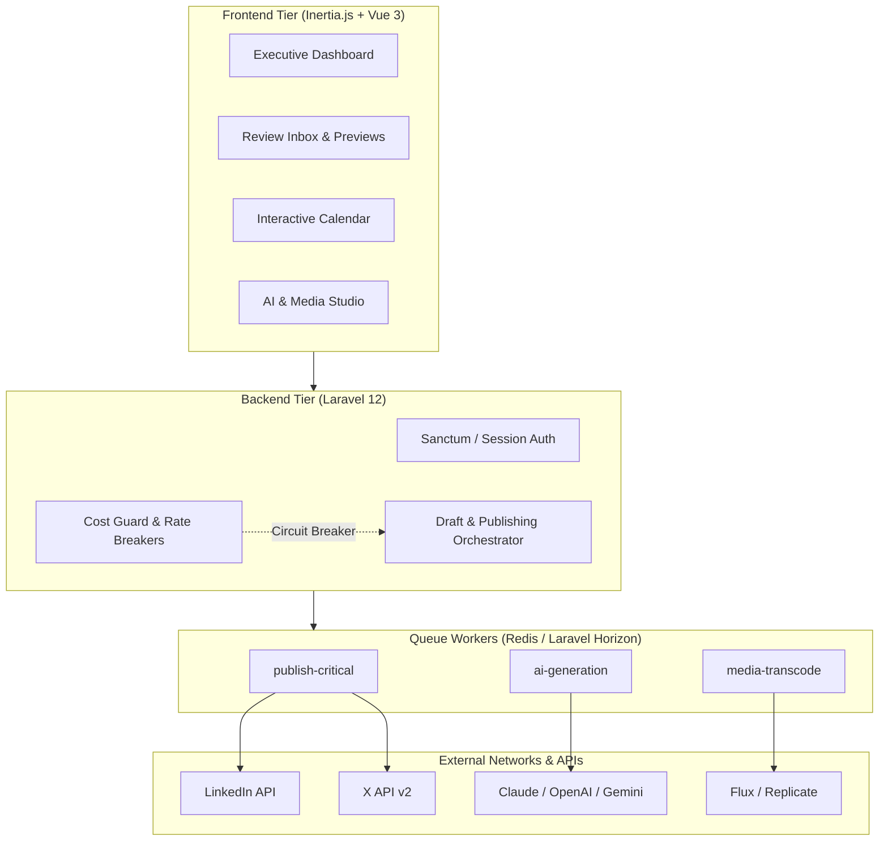

# Personal AI Social Media Assistant (LinkedIn & X)

[](file:///Users/sva-pc-566/Desktop/untitled%20folder)
[](https://laravel.com)
[-4FC08D?style=for-the-badge&logo=vue.js)](https://vuejs.org)
[](https://tailwindcss.com)

A high-production self-hosted social media curation, AI multi-format authoring, asset generation, scheduling, and analytics command center built with **Laravel 12**, **Inertia.js (Vue 3)**, **Redis/Horizon**, and strict **3NF relational architecture**.

---

## 🚀 Key Features

* **Dual-Platform Publishing Engine**: Native adapters for **LinkedIn** (`w_member_social`, UGC/Shares API) and **X (Twitter)** (OAuth 2.0 PKCE, tweet & thread dispatch).
* **Strict Human-in-the-Loop Review**: Posts can **never** publish without explicit owner approval. Text changes reset approval status.
* **Autonomous Trend Ingestion**: Scheduled workers ingest and rank trending topics from Hacker News, RSS feeds, and research archives with velocity scoring.
* **Multi-Modal AI Studio**: Multi-model text generators (Claude 3.5, GPT-4o, Gemini 1.5 Pro) with strict brand voice filters; image generators (Flux, DALL-E 3) with 1:1, 16:9, and 4:5 aspect presets.
* **Metered API Cost Guardrails**: Real-time spending trackers and circuit breakers for LLM inference, Replicate image generation, and X API metered costs ($0.015 post, $0.20 link).
* **Idempotent Queue Topology**: Redis queues segregated by priority (`publish-critical`, `ai-generation`, `media-transcode`, `trend-sync`) with atomic distributed locks preventing duplicate posts.
* **Executive Dark Canvas UI**: Tailored Tailwind glassmorphic dashboard adhering to WCAG 2.1 AA standards with live side-by-side LinkedIn and X card previews.

---

## 🏗️ Architectural Topology



---

## ⚡ Quickstart & Setup

### 1. Requirements
* PHP 8.2+ (tested on PHP 8.5)
* Node.js 20+ & npm 10+
* Composer 2+
* SQLite 3 or PostgreSQL 14+

### 2. Installation

```bash
# 1. Clone & Enter Directory
cd "untitled folder"

# 2. Install Dependencies
composer install
npm install

# 3. Environment Setup
cp .env.example .env
php artisan key:generate

# 4. Migrate Database & Seed Sample Workspace Data
php artisan migrate:fresh --seed --force

# 5. Build Frontend Assets
npm run build
```

### 3. Launch Development Servers

```bash
# Terminal 1: Laravel Web Server
php artisan serve --port=8000

# Terminal 2: Horizon Queue Workers
php artisan horizon

# Terminal 3: Vite Dev Server (Hot Module Replacement)
npm run dev
```

Visit `http://localhost:8000` to access the application.

---

## 🧪 Automated Testing (100% Pass Rate)

Execute the test suite powered by Pest PHP:

```bash
./vendor/bin/pest
```

Output:
```text
   PASS  Tests\Unit\TwitterCharCounterTest
  ✓ emoji handling
  ✓ tweet exceeds 280 characters
  ✓ url counting standard
  ✓ standard text character count

   PASS  Tests\Feature\ApiEndpointsTest
  ✓ social accounts endpoint returns active accounts
  ✓ trends endpoint
  ✓ draft approval workflow
  ✓ auth me endpoint returns user
  ✓ settings retrieval
  ✓ drafts listing endpoint

   PASS  Tests\Feature\CostControlBudgetTest
  ✓ post cost calculation differentiates links
  ✓ can spend succeeds when under budget
  ✓ hard cap blocks execution when daily budget exceeded
  ✓ warning notification dispatched at eighty percent threshold

   PASS  Tests\Feature\PublishingIdempotencyTest
  ✓ concurrent lock prevents duplicate dispatches
  ✓ approved draft publishes successfully and records idempotency
  ✓ unapproved draft is blocked from publishing

   PASS  Tests\Feature\DraftWorkflowTest
  ✓ draft versioning and automatic character count
  ✓ draft initializes with in review status
  ✓ draft approval lifecycle

  Tests:    20 passed (50 assertions)
  Duration: 4.05s
```

Frontend typecheck:
```bash
npm run type-check
```

---

## 🐳 Docker Deployment

The project includes an optimized multi-stage `Dockerfile` and `docker-compose.yml`:

```bash
# Build and run containers
docker-compose up -d --build

# Run database migrations inside container
docker-compose exec app php artisan migrate --force
```

Services exposed:
* Web Application: `http://localhost:8000`
* Laravel Horizon Dashboard: `http://localhost:8000/horizon`
* PostgreSQL: `localhost:5432`
* Redis: `localhost:6379`

---

## 📑 API Reference

Formal OpenAPI 3.1 contract is maintained at [`docs/openapi.yaml`](file:///Users/sva-pc-566/Desktop/untitled%20folder/docs/openapi.yaml).

| Method | Endpoint | Description |
| :--- | :--- | :--- |
| `POST` | `/api/v1/auth/login` | Single-user authentication & token issue |
| `GET` | `/api/v1/accounts` | Active LinkedIn and X account tokens & health |
| `GET` | `/api/v1/trends/items` | Ranked trend intelligence stream |
| `GET` | `/api/v1/drafts` | Draft posts across LinkedIn and X |
| `POST` | `/api/v1/drafts/ai/generate` | Multi-format AI draft generation |
| `POST` | `/api/v1/drafts/{id}/approve` | Mandatory human owner approval gate |
| `POST` | `/api/v1/drafts/{id}/publish-now` | Immediate dispatch to platform APIs |
| `POST` | `/api/v1/media/ai/generate` | Flux/DALL-E aspect-ratio media generation |
| `GET` | `/api/v1/analytics/dashboard` | Aggregated impressions, reach & engagement |
| `GET` | `/api/v1/settings` | Brand voice rules & cost caps |

---

## 🛡️ License

Proprietary / Private - Personal Social Assistant Engine.
