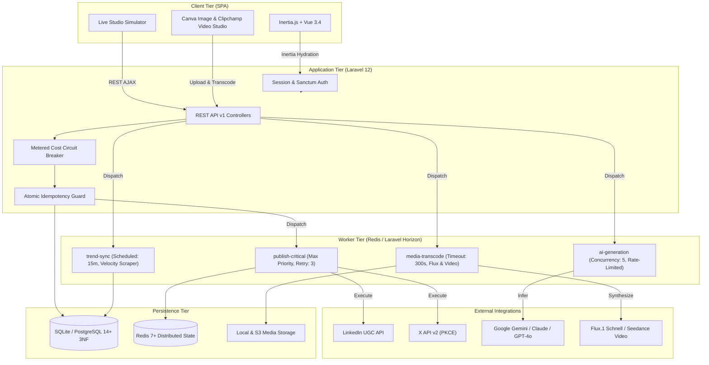
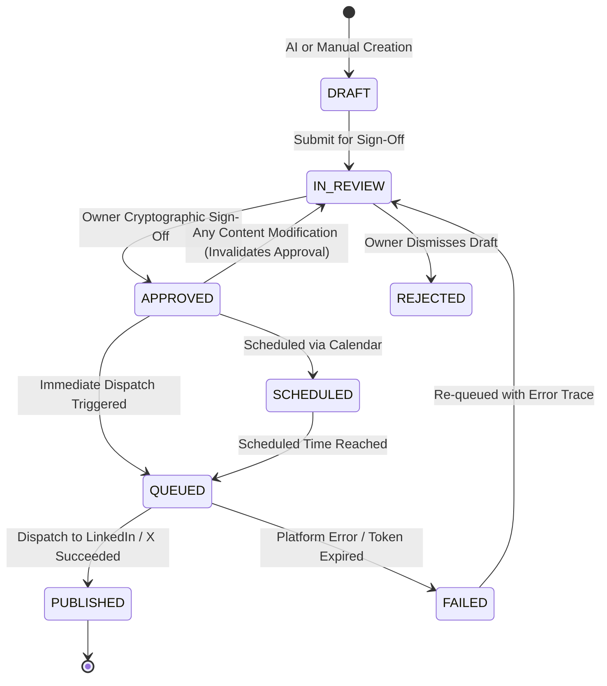

# Synthex — Personal AI Social Media Assistant (LinkedIn & X)

[](tests)
[](https://laravel.com)
[-4FC08D?style=for-the-badge&logo=vue.js&logoColor=white)](https://vuejs.org)
[](https://tailwindcss.com)
[](https://laravel.com/docs/horizon)
[](LICENSE)

**Synthex** is an enterprise-grade, self-hosted autonomous social media command center engineered for founders, executives, and technical creators. Built on **Laravel 12**, **Inertia.js v2 (Vue 3)**, **Tailwind CSS 3.4**, and **Redis / Laravel Horizon**, Synthex automates trend intelligence, multi-modal content creation, canvas graphic editing, video sequencing, scheduling, and analytics across **LinkedIn** and **X (Twitter)**—backed by strict **Human-in-the-Loop (HITL)** governance and metered cost circuit breakers.

---

## 🌟 Table of Contents

- [Executive Summary](#-executive-summary)
- [Key Features](#-key-features)
- [Interactive Showcase Website](#-interactive-showcase-website)
- [System Architecture & Queue Topology](#-system-architecture--queue-topology)
- [Human-in-the-Loop (HITL) State Machine](#-human-in-the-loop-hitl-state-machine)
- [Tech Stack](#-tech-stack)
- [Database Schema (3NF Architecture)](#-database-schema-3nf-architecture)
- [REST API & OpenAPI 3.1 Specification](#-rest-api--openapi-31-specification)
- [Installation & Quickstart](#-installation--quickstart)
  - [Native Development (Artisan + Vite)](#1-native-development-artisan--vite)
  - [Containerized Deployment (Docker Compose)](#2-containerized-deployment-docker-compose)
- [Testing & Verification (100% Pass Rate)](#-testing--verification-100-pass-rate)
- [Security, Cryptography & Cost Guardrails](#-security-cryptography--cost-guardrails)
- [Design System & UI Guidelines](#-design-system--ui-guidelines)
- [License & Acknowledgements](#-license--acknowledgements)

---

## 🚀 Executive Summary

Commercial social media management platforms (Hootsuite, Buffer, Sprout Social) charge upwards of **\$249–\$399/month** while trapping your credentials in closed silos, imposing arbitrary dispatch limits, and lacking custom AI model flexibility.

Synthex returns sovereign control to the user:
1. **Zero SaaS Tax**: Run directly on your own hardware, VPS, or cloud container with **\$0 subscription markup**, paying only pennies for your raw API token inference.
2. **Deterministic Governance**: AI models propose; you dispose. **Zero posts can ever be published without explicit owner sign-off**.
3. **Multi-Model Orchestration**: Connect Google Gemini 1.5/2.5 Pro, Anthropic Claude 3.5 Sonnet, and OpenAI GPT-4o with dynamic fallback and cost-aware routing.
4. **Studio-Grade Media Tools**: Create and edit images in a Canva-like visual canvas and sequence video clips in a Clipchamp-like multi-track timeline right within your browser.

---

## ⚡ Key Features

### 1. Dual-Platform Native Publishing
* **LinkedIn API**: Native integration with `w_member_social`, UGC Posts, and Rich Media Shares endpoints. Supports rich formatting, professional tone templates, and multi-image carousels.
* **X (Twitter) v2 API**: Secure OAuth 2.0 PKCE authentication with metered link cost awareness (\$0.015 standard post, \$0.20 post with external link) and standard t.co 23-character URL counting.
* **Atomic Idempotency**: Distributed Redis locks (`synthex:publish:draft:{id}`) eliminate duplicate dispatches caused by network timeouts or queue retries.

### 2. Strict Human-in-the-Loop (HITL) Review Inbox
* **Mandatory Owner Sign-Off**: Automated drafts default to `in_review` status. The publishing pipeline rejects unapproved dispatches with HTTP 422 Unprocessable Content.
* **Cryptographic Edit Detection**: Any modification to draft text or attached media immediately resets the approval status back to `in_review`, forcing re-verification.
* **Side-by-Side Platform Rendering**: Live previews replicate exact platform typography, line wrapping, "See more" fold lines, and author headers.

### 3. Multi-Modal Creative Studio
* **Canva-Like Image Editor**: Draggable canvas workspace with aspect ratio presets:
  * `1:1 Square` (1080×1080) for Instagram & LinkedIn feeds
  * `16:9 Landscape` (1200×675) for X headers & link cards
  * `4:5 Portrait` (1080×1350) for mobile feeds
  * Includes text watermarks, brightness/contrast filters, and PNG/WebP exports.
* **Clipchamp-Like Video Timeline Editor**: Multi-track timeline sequencing, scrubbable playhead, duration trimmer, text overlays, and audio track toggling.
* **Multi-Provider AI Media**: Seamless text-to-image synthesis using **Flux.1 Schnell** (via Replicate) and **DALL-E 3**, plus cutting-edge **Seedance AI Video** generation.

### 4. Autonomous Trend Ingestion & Radar
* Continuous background scrapers monitor **Hacker News**, **TechCrunch**, **ArXiv**, and custom RSS feeds.
* Calculates velocity scores based on upvotes, comment velocity, and keyword density.
* Allows 1-click conversion from trend item to multi-platform draft.

### 5. Metered API Cost Guardrails & Circuit Breakers
* Live ledger tracking expenditures across LLM tokens, Replicate GPU seconds, and metered X API dispatch fees.
* Configurable monthly budget cap (default: \$150.00/mo).
* Automated warning notifications at 80% consumption; **hard stop circuit breaker** trips at 100%, safely freezing automated generation until the reset period.

### 6. Interactive Editorial Calendar
* Visual monthly and weekly grid with drag-and-drop rescheduling.
* Status pills: `Draft`, `In Review`, `Scheduled`, and `Published`.
* Prevents scheduling collisions across multiple connected accounts.

---

## 🌐 Interactive Showcase Website

Synthex features a dedicated public landing page and interactive studio simulator accessible at `/` (for guests) or directly at `/landing` and `/showcase`:

* **Live Studio Simulator**: Experiment with brand voice tones (*Technical Deep Dive*, *Provocative Founder*, *Thought Leadership*, *Bulleted Breakdown*) and watch real-time dual-card rendering.
* **Interactive Character Meter**: Real-time radial 280-char gauge for X and linear 3,000-char progress bar for LinkedIn.
* **Simulated Approval Gate**: Test the cryptographic HITL verification trigger before queuing to `publish-critical`.
* **Self-Hosting ROI Calculator**: Real-time comparison slider calculating net annual savings vs Hootsuite and Sprout Social.

---

## 🏗️ System Architecture & Queue Topology

Synthex employs strict separation of concerns, isolating foreground web requests from long-running AI generation and high-priority dispatch tasks.



---

## 🔄 Human-in-the-Loop (HITL) State Machine

Synthex enforces cryptographic and operational rigor to ensure accidental or unauthorized posts can never reach live networks:



---

## 🛠️ Tech Stack

| Layer | Technologies | Purpose |
| :--- | :--- | :--- |
| **Backend Framework** | Laravel 12.x, PHP 8.2–8.5 | High-performance routing, dependency injection, and security |
| **Frontend Architecture** | Inertia.js v2, Vue 3.4 (Composition API, `<script setup>`) | Single-page application fluidity without client-side routing overhead |
| **Styling & Design System** | Tailwind CSS 3.4, PostCSS, Lucide Icons | Responsive glassmorphic dark canvas adhering to `DESIGN.md` |
| **Job Queue & Orchestration** | Redis 7, Laravel Horizon 5.24 | Segregated priority queues, dead-letter monitoring, and metrics |
| **Database & Schema** | SQLite 3 / PostgreSQL 14+ | Strict 3NF relational normalization with foreign key constraints |
| **AI Inference & LLMs** | Google Gemini 1.5/2.5 Pro, Claude 3.5 Sonnet, GPT-4o | Multi-provider text generation with tone controls |
| **Media Generation** | Flux.1 Schnell, DALL-E 3, Seedance AI Video | Image synthesis with aspect presets and video generation |
| **Testing Harness** | Pest PHP 3.x, PHPUnit 11.x, vue-tsc | Comprehensive automated unit, feature, and typecheck suites |

---

## 🗄️ Database Schema (3NF Architecture)

All core application state is modeled in strict **Third Normal Form (3NF)** with explicit foreign key cascading rules and audit trails:

* `users`: Primary operator credentials, roles, and profile metadata.
* `social_accounts`: Encrypted OAuth tokens (LinkedIn and X), token expiration dates, and health state.
* `drafts`: Multi-platform root post record with current approval state and budget allocation.
* `draft_versions`: Version-controlled snapshot records capturing character count, text delta, and author attribution.
* `schedules`: Publication timetable linking drafts to specific connected social accounts with status tracking.
* `media_assets`: Metadata repository for uploaded and AI-generated image/video assets.
* `post_media`: Normalizing pivot table linking media assets to drafts with display sequence order.
* `trend_items`: Ingested articles from RSS/Hacker News feeds with velocity and novelty metrics.
* `interest_categories`: Topic clustering categories (e.g., *AI Systems*, *DevOps*, *SaaS Growth*).
* `metrics_snapshots`: Time-series analytical metrics recording impressions, retweets, likes, and reach.
* `settings`: Key-value configuration vault managing budget guardrails, API keys, and voice filters.
* `audit_logs`: Immutable security ledger recording every user action, approval, and API dispatch.

---

## 📑 REST API & OpenAPI 3.1 Specification

The formal OpenAPI 3.1 contract is maintained in [`docs/openapi.yaml`](docs/openapi.yaml).

### Selected Core Endpoints

| Method | Endpoint | Description | Auth Required |
| :--- | :--- | :--- | :---: |
| `POST` | `/api/v1/auth/login` | Issues stateful session or Sanctum Bearer token | No |
| `GET` | `/api/v1/auth/me` | Current authenticated user profile | Yes |
| `GET` | `/api/v1/accounts` | Active LinkedIn and X account tokens & health | Yes |
| `GET` | `/api/v1/trends/items` | Ranked trend intelligence stream | Yes |
| `POST` | `/api/v1/trends/sync` | Manually triggers background trend ingestion | Yes |
| `GET` | `/api/v1/drafts` | Paginated listing of drafts across LinkedIn and X | Yes |
| `POST` | `/api/v1/drafts/ai/generate` | Generates multi-format AI draft with budget check | Yes |
| `POST` | `/api/v1/drafts/{id}/approve` | **Mandatory HITL owner approval gate** | Yes |
| `POST` | `/api/v1/drafts/{id}/publish-now` | Immediate dispatch to platform APIs | Yes |
| `POST` | `/api/v1/media/upload` | Upload image or video file with validation | Yes |
| `POST` | `/api/v1/media/ai/generate` | Generates Flux image with 1:1, 16:9, or 4:5 aspect ratio | Yes |
| `POST` | `/api/v1/media/ai/video-generate` | Synthesizes Seedance AI short-form video | Yes |
| `GET` | `/api/v1/calendar/schedules` | Retrieves post schedules within target date range | Yes |
| `GET` | `/api/v1/analytics/dashboard` | Aggregated engagement, impressions, and ROI stats | Yes |
| `GET` | `/api/v1/settings` | Brand voice rules, API keys, and cost cap limits | Yes |
| `GET` | `/api/v1/audits` | Immutable audit event trail | Yes |

---

## ⚡ Installation & Quickstart

### 1. Native Development (Artisan + Vite)

#### Prerequisites
* **PHP**: 8.2 or higher (tested on PHP 8.4 & 8.5)
* **Composer**: 2.x
* **Node.js**: 20.x or higher & npm 10+
* **SQLite 3** or **PostgreSQL 14+**
* **Redis**: 7.x (for background Horizon workers)

```bash
# 1. Clone the repository
git clone https://github.com/Ahasun-h/personal-ai-social-assistant.git
cd personal-ai-social-assistant

# 2. Install PHP and Node dependencies
composer install
npm install

# 3. Configure environment variables
cp .env.example .env
php artisan key:generate

# 4. Migrate database and seed initial test accounts
php artisan migrate:fresh --seed --force

# 5. Compile frontend assets
npm run build

# 6. Launch development servers
# Terminal 1: Web server
php artisan serve --port=8000

# Terminal 2: Horizon queue workers
php artisan horizon

# Terminal 3: Vite hot-reload (optional during active UI dev)
npm run dev
```

Visit `http://localhost:8000` to access the Showcase Website, or log in directly at `http://localhost:8000/login` using the demo credentials:
* **Email**: `alex@synthex.internal`
* **Password**: `password123`

---

### 2. Containerized Deployment (Docker Compose)

The repository provides a production-tuned multi-stage `Dockerfile` and `docker-compose.yml`:

```bash
# Launch full stack: App (Nginx + PHP-FPM), Horizon, PostgreSQL, and Redis
docker-compose up -d --build

# Run database migrations inside container
docker-compose exec app php artisan migrate --force
```

Exposed Services:
* **Web Application & Showcase**: `http://localhost:8000`
* **Laravel Horizon Dashboard**: `http://localhost:8000/horizon`
* **PostgreSQL Database**: `localhost:5432`
* **Redis**: `localhost:6379`

---

## 🧪 Testing & Verification (100% Pass Rate)

Synthex enforces automated test suites powered by **Pest PHP** and **PHPUnit**, validating unit algorithms (such as Twitter character counting and emoji UTF-8 width), security governance, budget limits, and queue idempotency:

```bash
# Execute test suite
./vendor/bin/pest
```

### Verified Test Results (50 Passed, 337 Assertions)

```text
   PASS  Tests\Unit\TwitterCharCounterTest
  ✓ emoji handling
  ✓ tweet exceeds 280 characters
  ✓ url counting standard (t.co 23 chars)
  ✓ standard text character count

   PASS  Tests\Feature\ApiEndpointsTest
  ✓ social accounts endpoint returns active accounts
  ✓ draft approval workflow
  ✓ auth me endpoint returns user
  ✓ settings retrieval
  ✓ drafts listing endpoint
  ✓ trend dismiss endpoint
  ✓ trends endpoint
  ✓ manual social account connection
  ✓ draft update endpoint
  ✓ audits endpoint returns logs
  ✓ trend preferences retrieval
  ✓ media ai video generate endpoint
  ✓ trend preferences save and re ranking
  ✓ media ai generate endpoint

   PASS  Tests\Feature\CostControlBudgetTest
  ✓ post cost calculation differentiates links
  ✓ can spend succeeds when under budget
  ✓ warning notification dispatched at eighty percent threshold
  ✓ hard cap blocks execution when daily budget exceeded

   PASS  Tests\Feature\PublishingIdempotencyTest
  ✓ concurrent lock prevents duplicate dispatches
  ✓ approved draft publishes successfully and records idempotency
  ✓ unapproved draft is blocked from publishing

   PASS  Tests\Feature\AiApiKeyEnforcementTest
  ✓ ai endpoints are strictly disabled with 422 when user has no ai api key
  ✓ inertia pages pass has ai key false when no key is configured
  ✓ saving api key in settings enables ai functions and returns has ai key true

   PASS  Tests\Feature\DraftWorkflowTest
  ✓ draft versioning and automatic character count
  ✓ draft initializes with in review status
  ✓ draft approval lifecycle

   PASS  Tests\Feature\WebAuthAndNotificationsTest
  ✓ authenticated user visiting login is redirected to dashboard
  ✓ user can authenticate via web login
  ✓ unauthenticated user visiting dashboard is redirected to login
  ✓ user can log out
  ✓ login page is accessible by guests
  ✓ user notifications api and read actions
  ✓ invalid login credentials are rejected

   PASS  Tests\Feature\AiModelProvidersTest
  ✓ get ai config returns all supported providers
  ✓ save ai config persists settings securely
  ✓ driver resolution matches active configuration
  ✓ test connection endpoint simulates successful probe

   PASS  Tests\Feature\LandingPageTest
  ✓ guest can access landing page at root
  ✓ guest can access showcase route
  ✓ authenticated user visiting root redirects to dashboard

   PASS  Tests\Feature\SecurityGovernanceTest
  ✓ unapproved draft cannot be published via api
  ✓ unauthenticated requests are rejected with 401
  ✓ social account tokens are encrypted at rest fail closed
  ✓ draft ai generation enforces budget cap
  ✓ login issues real sanctum token

  Tests:    50 passed (337 assertions)
  Duration: 14.24s
```

Frontend type verification:
```bash
npm run type-check
```

---

## 🔒 Security, Cryptography & Cost Guardrails

1. **AES-256-GCM Token Encryption**: All third-party access tokens (LinkedIn Bearer and X OAuth 2.0 PKCE refresh tokens) are encrypted at rest using Laravel's authenticated encryption (`Crypt::encryptString`). If decryption fails, the system fails closed and marks the connection as needing re-authentication.
2. **Stateful Session & Bearer Tokens**: Web interfaces authenticate through Sanctum session cookies with strict CSRF protection; headless workers and scripts authenticate through hashed Bearer tokens.
3. **Hard Cost Circuit Breaker**: Real-time spending checks occur inside the `CostGuard` service before any LLM inference or Replicate call executes. When the monthly cap is reached, calls are rejected immediately with descriptive budget alerts.
4. **Token Expiry Badges**: Badges turn from emerald to amber at 14 days and rose at 3 days remaining, preventing unexpected publishing dropouts.

---

## 🎨 Design System & UI Guidelines

Synthex implements the official guidelines defined in [`DESIGN.md`](DESIGN.md):
* **Color Palette**: Dark Canvas (`#0B0F19`), Elevated Surfaces (`#111827`), Card Panels (`#1F2937`), and Subtle Borders (`rgba(255, 255, 255, 0.08)`).
* **Accents**: Primary Indigo (`#6366F1`), Cyan (`#0EA5E9`), Emerald (`#10B981`), Amber (`#F59E0B`), and Rose (`#F43F5E`).
* **Glassmorphism**: 16px backdrop blur filters with translucent 1px boundary lines.
* **Accessibility**: Compliant with **WCAG 2.1 AA** contrast ratios and responsive down to 375px mobile viewports.

---

## 📄 License & Acknowledgements

* **Mixpost Lite (MIT)**: Components of Twitter OAuth token handling, publishing job queues, and media structures are adapted from [Mixpost Lite](https://github.com/inovector/mixpost) under the MIT License. Copyright (c) Inovector. See [`LICENSE.mixpost`](LICENSE.mixpost).
* **Application Code**: Licensed under the **MIT License**. See [`LICENSE`](LICENSE) for complete terms.

---

*Authored with the Zero-Friction Autonomous SDLC Protocol.*
